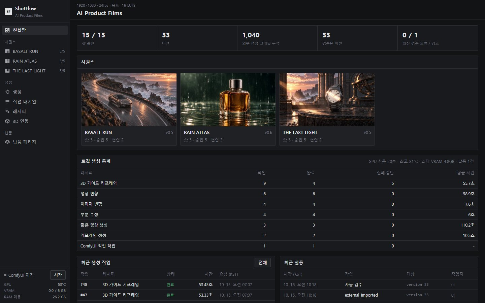
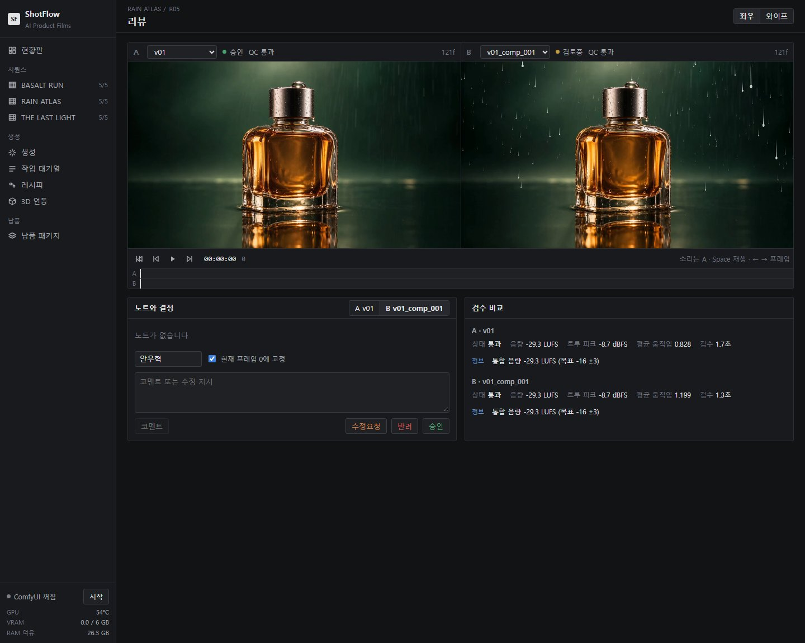
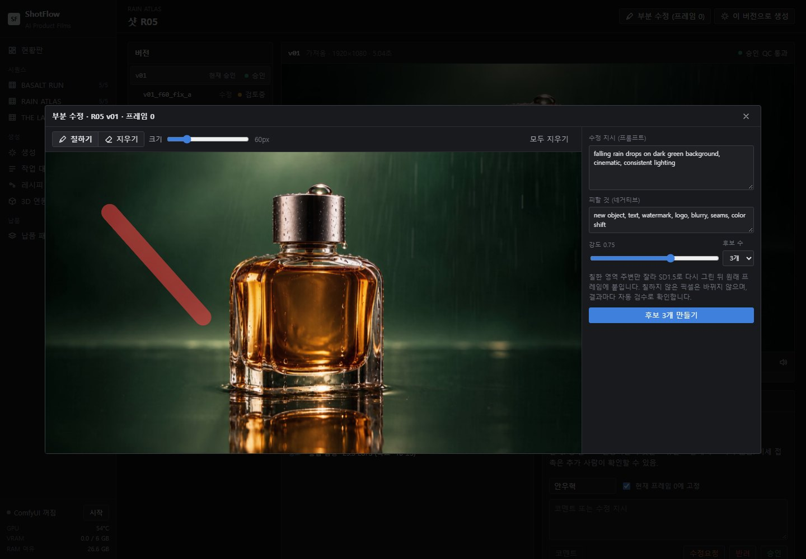
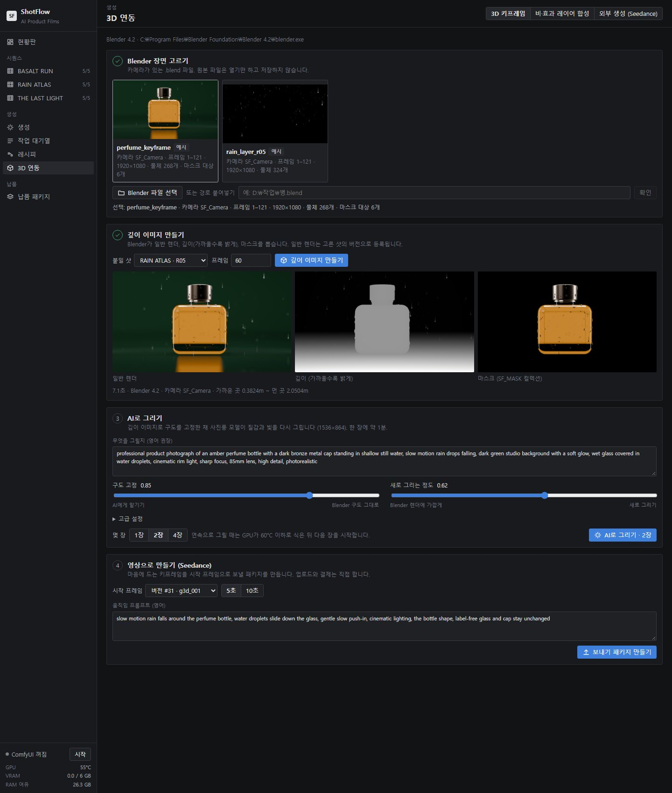

# ShotFlow

AI로 영상을 만들 때 쓰는 샷·버전 관리 툴. 생성, 검수, 리뷰, 편집 조립, 납품까지 한 곳에서 관리한다.

시연 영상: https://drive.google.com/file/d/1RI8OWRvl6j10BQPL48odNolKSsjEqjQs/view



## 왜 만들었나

AI로 제품 광고 영상 3편(클립 16개)을 만들고 나니 폴더가 엉망이었다. 같은 샷의 "백업", "교체전", "연결전" 파일이 수십 개였고, 프롬프트·작업 ID·크레딧 기록은 샷마다 JSON 4~5개에 흩어져 있었다. 편집 구간은 스크립트 안에 하드코딩돼 있어서 샷 하나를 바꾸려면 코드를 고쳐야 했다.

제일 컸던 건 검수였다. 향수 영상에서 4번째 컷은 비가 내리는데 5번째 컷은 비가 없는 스튜디오로 바뀌어 있었다. 해상도, 길이, 음량 같은 기술 검사는 다 통과했다. 컷과 컷 사이를 따로 확인하는 단계가 없어서 놓친 것이다.

그래서 처음부터 이 툴로 영상을 만들 수 있게 했다. 어떤 결과물이든 어떤 원본에서, 어떤 설정과 시드로, 얼마를 써서 나왔는지 따라갈 수 있어야 한다는 게 출발점이었다.

## 기능

- **샷·버전 관리**: 프로젝트 → 영상 → 샷 → 버전 구조. 버전마다 부모 버전이 있어서 생성 → 수정 → 합성 흐름이 계보로 남고, 샷마다 승인 버전 하나를 가리킨다. 원본 파일은 읽기만 한다.
- **자동 검수**: 버전을 등록하면 바로 돈다. 규격, 검은 화면, 멈춘 화면, 깜빡임, 숨은 컷, 무음/클리핑, 음량(-16 LUFS 기준)을 보고, 모든 컷의 앞뒤 프레임을 나란히 놓은 경계 비교 시트도 만든다.
- **리뷰**: 두 버전 동기 재생, 프레임 단위 노트, 승인/반려/수정요청.
- **ComfyUI 연결**: ComfyUI 워크플로를 레시피로 등록해 버전 관리한다. 노드 제목에 `SF:`를 붙인 입력만 화면에 폼으로 나온다. 시드·강도 조합을 한 번에 돌리는 변형 그리드와 작업 대기열이 있다.
- **부분 수정**: 프레임에 마스크를 칠하면 인페인트 후보를 여러 개 만들어 원래 버전의 자식 버전으로 등록한다.
- **Blender 연결**: `.blend`를 열어 일반 렌더, 깊이, 마스크, 효과 레이어(비·반짝임·먼지)를 뽑는다. 깊이 이미지를 ControlNet에 넣어 AI 그림의 구도를 3D 장면에 고정한다.
- **외부 생성 기록**: Higgsfield(Seedance)에 넣을 시작 프레임과 프롬프트를 패키지로 묶고, 결과 영상과 쓴 크레딧을 다시 등록한다. API 연결은 없고 제출은 직접 한다.
- **편집 조립·납품**: 영상마다 EDL을 두고 승인 버전으로 편집본을 조립한다. 납품은 승인본만 이름 규칙대로 모아 SHA-256 체크섬을 붙인다.
- **ComfyUI 전용 노드**: ComfyUI 안에서 ShotFlow 버전을 불러오고(Load Version), 결과를 바로 ShotFlow 버전으로 등록한다(Publish).

| 리뷰 | 부분 수정 |
|---|---|
|  |  |



## 실제로 쓴 기록

2026년 11월 기준. 영상 6편을 이 툴로 관리했다.

| 항목 | 수 |
|---|---|
| 샷 | 46 |
| 버전 | 216 |
| 생성 작업 | 235 (ComfyUI 107, Blender 72, Higgsfield 50, 합성 5, ComfyUI 노드 1) |
| 레시피 | 6 |
| 자동 테스트 | 92 (모두 통과) |

## 만들면서 정한 것들

막힐 때마다 재 보고 정했다. 자세한 건 [설계서](docs/설계서.html) 아래쪽 결정기록 D-001 ~ D-014에 있다.

- **컷 경계 문제는 픽셀 통계로 못 잡는다.** 비가 사라진 컷(R04→R05)의 평균색 차이 ΔE는 3.7로, 문제없는 다른 컷(3.3~21.2)과 구분이 안 됐다. 색 분포, 질감, 움직임 지표도 마찬가지였다. 그래서 자동 판정 대신 경계 비교 시트를 만들어 사람이 빠르게 보게 했다.
- **숨은 컷 감지.** 처음 쓴 히스토그램 방식은 실제 컷 4개를 다 놓치고 페이드를 컷으로 잡았다. 프레임 차이 15 이상, 주변 12프레임 대비 5배 이상, 한 프레임에서만 바뀜, 이 세 조건으로 바꾼 뒤 실제 컷 12개를 모두 잡았고 오탐은 0이었다.
- **인페인트는 잘라서 고치고 다시 붙인다.** 1920×1080 전체를 SD1.5로 돌리면 6GB에서 무리이고, VAE를 거치면서 마스크 밖도 조금씩 변한다. 마스크 주변만 512로 잘라 고친 뒤 원본에 다시 합성했다. 실제 프레임 4건 모두 마스크 밖 1,896,759픽셀 중 바뀐 픽셀은 0개였다.
- **Wan 영상 변형 결과가 깨지던 원인.** 해상도, 정밀도, 타일 처리를 하나씩 바꿔 봤지만 원인이 아니었다. 범인은 노이즈 시프트였다. 시프트 8에서는 강도 0.6이 실제로는 약 92% 노이즈가 된다. 영상 변형 기본값을 시프트 3, 강도 0.35로 바꿨다.
- **노트북 GPU(6GB) 온도.** 3D 가이드 그림 한 장이 GPU 온도를 약 20°C 올려서, 연속으로 돌리면 두 번째 장에서 83°C 보호 기준에 걸렸다. GPU 작업은 60°C까지 식힌 뒤 시작하게 했다.
- **실행 파일(.cmd)은 영문만.** cmd.exe가 UTF-8로 저장된 배치 파일의 한글 줄을 잘못 읽어 설치가 멈췄다. `.cmd`는 짧은 영문 파일로 두고 안내 문구는 Python 쪽(`backend/install.py`)에서 출력한다.

## 구조

```
backend/        FastAPI 서버, SQLite(SQLAlchemy), 검수·조립·작업 대기열, 테스트
frontend/       React + TypeScript (Vite)
integrations/   Blender 안에서 도는 렌더 스크립트, ComfyUI 전용 노드
recipes/        ComfyUI 워크플로 레시피 (API JSON + 화면용 설정)
scenes/         Blender 장면을 만드는 스크립트
edits/          편집본 EDL
docs/           설계서, 사용안내, 따라하기, 작업일지
```

- 서버는 127.0.0.1에서만 열린다. 로컬 1인 사용 기준이다.
- GPU 작업(ComfyUI, Blender)은 대기열에서 하나씩 돈다. 6GB 하나를 같이 쓰지 않게 하려는 것이다.
- ComfyUI는 ShotFlow가 직접 띄운다. 입력·출력 폴더를 `data/comfy`로 잡고, 전용 노드는 ComfyUI 폴더에 설치하지 않은 채 불러온다.
- Blender는 `-b --factory-startup`으로 실행한다. 개인 설정을 읽지 않고, `.blend` 파일도 저장하지 않는다.

## 실행

Windows 기준이다. Python 3.10 이상과 Node.js 20 이상이 필요하다.

```
설치.cmd      # .venv, 패키지, 화면 빌드, DB 생성 (이 폴더 안에만 설치)
시작.cmd      # http://127.0.0.1:8710
```

ComfyUI와 Blender 연결은 선택이다. 없으면 해당 메뉴만 쓸 수 없다.

| 환경 변수 | 용도 |
|---|---|
| `SHOTFLOW_COMFY_ROOT` | ComfyUI portable 폴더 |
| `SHOTFLOW_MODELS` | 모델 폴더 (기본 `data/models`) |
| `SHOTFLOW_BLENDER` | blender.exe 경로 (Blender 4.2 LTS로 테스트) |
| `SHOTFLOW_DATA` | 데이터 폴더 (기본 `data`) |

사용한 모델: Realistic Vision V6.0, ControlNet v1.1 depth(fp16), sd-vae-ft-mse. 저장소에는 넣지 않았다.

Blender 장면 파일도 빠져 있다. 스크립트로 다시 만들 수 있다.

```
blender -b --factory-startup --python scenes/first_drop/build_scenes.py
```

테스트:

```
cd backend
..\.venv\Scripts\python -m pytest
```

예전 제작 기록, ComfyUI 노드 정보, Blender가 없는 PC에서는 그게 필요한 테스트만 건너뛴다.

## 한계

- 로그인, 권한, 동시 편집이 없다. 소규모 팀으로 넓히는 건 구조만 대비해 뒀다.
- 6GB GPU라 로컬 생성은 SD1.5와 Wan 1.3B 저해상도까지다. 최종 고화질 영상은 Higgsfield(Seedance)로 만들고, 로컬은 키프레임, 부분 수정, 구도 고정을 맡는다.
- 화면과 문서는 한국어다.
